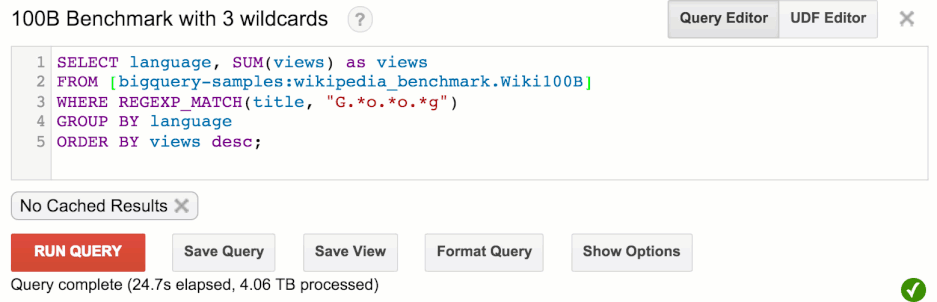

## BigQuery: The modern cloud data warehouse (Virtual Infrastructure)

To execute a single complex query (1Tb scan with Regex). BQ dyamically assesmbles a massive temporary data centre.

1. Storage & Disk throughput (Colossus):
    - BQ reads data from colossus(Google's distributed file system)
    - For 1 Tb scan, BQ utilizes the throughput of 330 Hard disks that support 100MB/sec speed.
    - BQ extracts only the bytes from specific columns that are queried, bypassing irrelevant data.

2. Networking & Shuffle (Jupiter)
    - Jupiter provides 1 Petabit/sec 
    - It uses 330 Gigabit network to shuffle the 1.25 TB of data (1 Tb compressed for  intial read and 0.25 tb for aggregation)
3. Compute & CPU (slots)
    - A Slot is BigQuery’s unit of compute—an abstraction of CPU, RAM, and local I/O. Think of 1 slot as roughly 1 vCPU.
    - A heavy query can burst to 3,000+ slots (cores) to handle tasks like uncompressing 1TB of data or executing 100 billion regular expressions in parallel.
    - Google’s Borg (cluster manager) doles out these slots from a pool of hundreds of thousands of machines, ensuring your job gets the 3,300 cores it needs for 30 seconds and releases them the moment it’s done.

### The workflow: 

**Query Planning**: The Root node breaks your SQL into a "Query Plan" (a series of stages).

**Dynamic Dispatch**: BigQuery looks at the available Slots and dispatches the work.

**Parallel Scan**: Thousands of leaf nodes pull compressed chunks of data from Colossus simultaneously.

**Execution**: The leaf nodes execute your regex and logic at the microsecond level.

**Aggregation**: Data is "shuffled" across the Jupiter network and passed back up the tree to be returned as a single result set.

### Useful Resources
- [BigQuery Under the Hood](https://cloud.google.com/blog/products/bigquery/bigquery-under-the-hood)
- [Anatomy of BigQuery Query](https://cloud.google.com/blog/products/bigquery/anatomy-of-a-bigquery-query)
- [Inside BQ Storage](https://cloud.google.com/blog/products/bigquery/inside-capacitor-bigquerys-next-generation-columnar-storage-format)